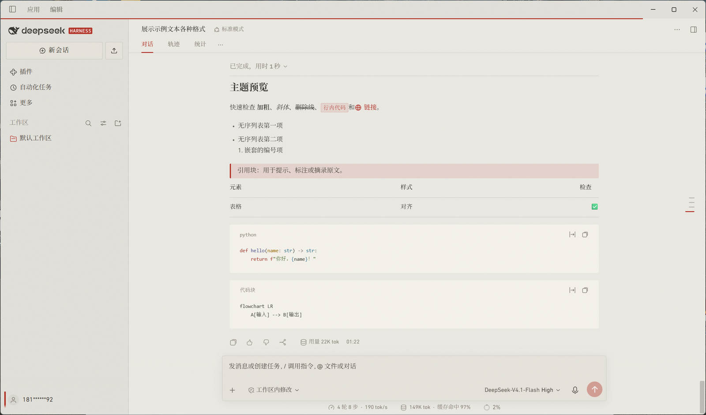
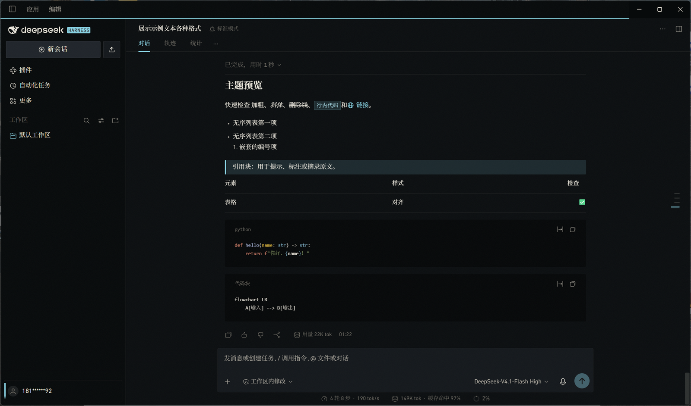

# nasapunk-theme

A NASA-punk / Starfield-flavoured visual theme for the DeepSeek Harness web client.

Warm paper and ink hairlines in light mode, instrument blue on graphite in dark mode.
It is an **override layer**, not a registered theme: it follows your Appearance setting,
never hijacks the preference, and uninstalling restores the stock look instantly.

## Screenshots

| Light — paper and sealing-wax red | Dark — graphite and instrument blue |
| --- | --- |
|  |  |

## What it changes

- **Surfaces** — paper `#EAE8E2` / sheet `#F3F1EC` / ink `#3A3732` in light mode;
  near-black graphite `#0B0E10` with bone text in dark mode. No glass, no gradients.
- **Accents** — sealing-wax red `#B3352A` in light, instrument blue `#86CFE0` in dark
  (sampled from a cockpit-display reference). Error stays red in both modes.
- **Type** — DIN Next LT Pro for Latin, Noto Serif SC for Chinese, Consolas for code.
- **Structure** — square window corners, a 2px chrome rule under the titlebar, 1px
  hairlines, 3px panel radius, a paper-fibre noise layer at 3–5% multiply.
- **Details** — inline code chips, blockquote rules, task checkboxes, the turn rail,
  the question card's recommended badge, segmented controls, the selected conversation row.

## Install

Requires a DeepSeek Harness build that supports client plugins.

```bash
# from a checkout of this folder
dsh plugin install ./nasapunk-theme
```

Or add it to a bundle and install that bundle. The plugin exposes
`dsh.bundle.patch` + `dsh.client` (web platform, injected immediately) in `package.json`,
so it can also be dropped into a profile's plugin list by hand.

After installing, reload the window (`Ctrl+R`, or `Ctrl+Shift+R` if the stylesheet is cached).

## Files

| Path | Purpose |
| --- | --- |
| `client.js` | The whole theme: 77 token overrides + the structural stylesheet |
| `package.json` | Plugin manifest (`dsh.bundle.patch`, `dsh.client`) |
| `cordis.patch.yml` | Bundle patch that inserts the plugin |
| `icon.svg`, `locale/` | Plugin metadata |
| `docs/DETAIL.md` | Design notes: typography, structural layer, palette, known gaps |

## Design notes

The interface is treated as a paper document in light mode and as a cockpit instrument
panel in dark mode. One accent per mode, everything else is ink and surface. Signals
carry meaning: red/blue for interaction, red for error, olive for success. Decorative
additions that read as noise (corner brackets, multi-coloured headings, glow rails)
were tried and removed.

## Known limits

- Structural selectors rely on CSS-module local names that DSH preserves; a DSH update
  that renames them makes the affected flourish disappear silently (layout never breaks).
- Product icons are hard-coded SVGs; only their colour is retargeted.
- The preset chip shows the raw preset id when the preset carries its own `name` field,
  because the app skips localisation in that case.

## License

MIT
