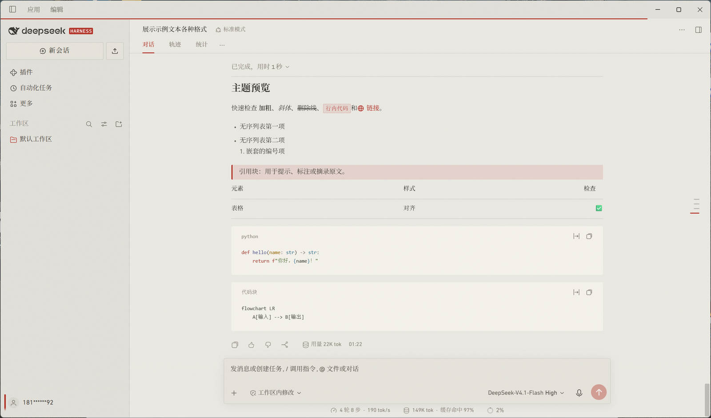
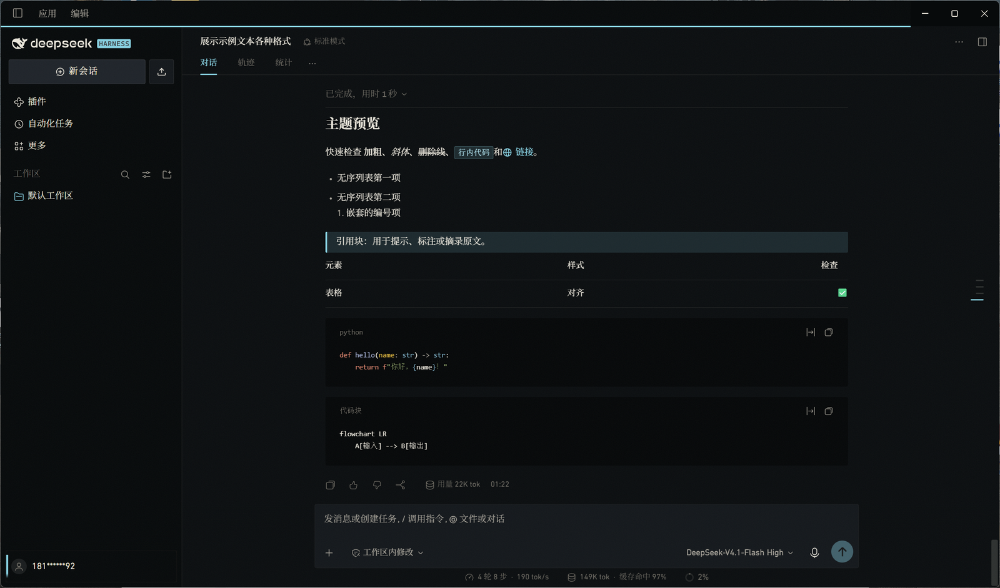
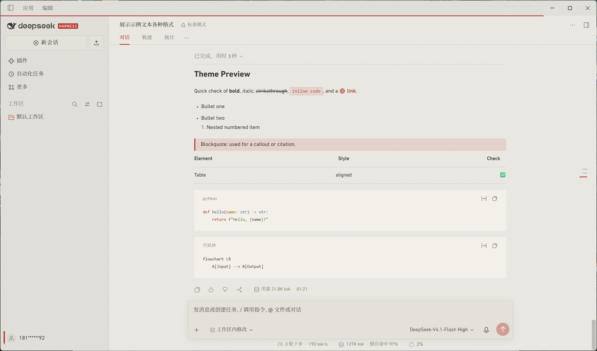
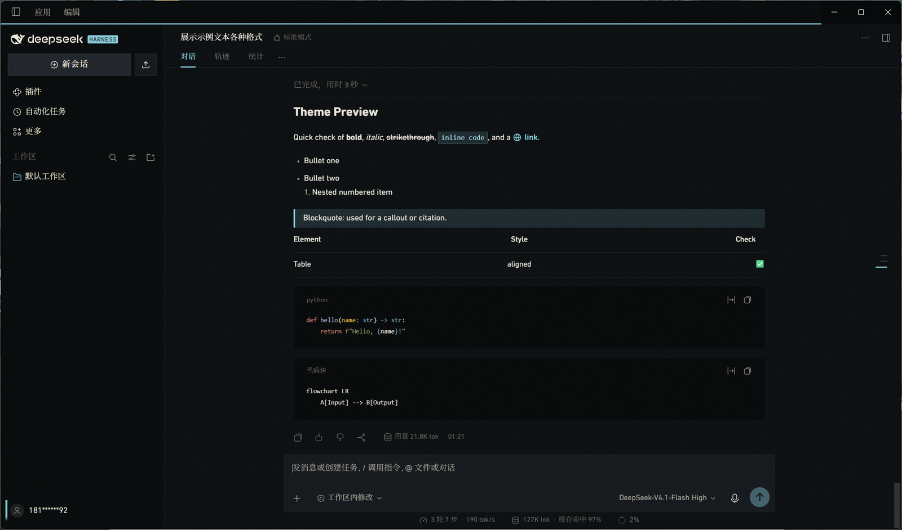

# nasapunk-theme

[English](README.md) | **简体中文**

一套 NASA-Punk / Starfield 风格的 DeepSeek Harness 网页端视觉主题。

浅色模式是暖纸底与墨色发丝线，深色模式是石墨底与仪表蓝。它是一层**覆盖层**而非注册主题：
跟随你的「外观」设置，不会劫持偏好，卸载后立即恢复原生界面。

## 截图

| | 浅色 — 纸与印章红 | 深色 — 石墨与仪表蓝 |
| --- | --- | --- |
| 中文 |  |  |
| English |  |  |

## 改了什么

- **表面** — 浅色下是纸 `#EAE8E2` / 卡片 `#F3F1EC` / 墨字 `#3A3732`；深色下是近黑石墨
  `#0B0E10` 配骨白字。没有玻璃拟态，没有渐变。
- **强调色** — 浅色用印章红 `#B3352A`，深色用仪表蓝 `#86CFE0`（取自一张座舱显示屏的采样）。
  错误态在两种模式下都保持红色。
- **字体** — 拉丁用 DIN Next LT Pro，中文落思源宋体，代码用 Consolas。
- **结构** — 窗口直角、标题栏下沿 2px 细线、1px 发丝线、3px 面板圆角、
  3–5% 正片叠底的纸纤维噪点。
- **细节** — 行内代码胶囊、引用块竖线、任务勾选框、轮次刻度、提问卡的「推荐」徽标、
  分段控件、左栏当前选中的对话行。

## 安装

需要一个支持客户端插件的 DeepSeek Harness 版本。

```bash
# 在本目录的检出里执行
dsh plugin install ./nasapunk-theme
```

也可以把它加进一个 bundle 再安装整个 bundle。`package.json` 里声明了
`dsh.bundle.patch` 与 `dsh.client`（web 平台、立即注入），所以也能手工放进
profile 的插件列表。

安装后重载窗口（`Ctrl+R`；若样式被缓存则用 `Ctrl+Shift+R`）。

## 文件

| 路径 | 作用 |
| --- | --- |
| `client.js` | 主题本体：77 个 token 覆盖 + 结构样式表 |
| `package.json` | 插件清单（`dsh.bundle.patch`、`dsh.client`） |
| `cordis.patch.yml` | 把插件插入 bundle 的补丁 |
| `icon.svg`、`locale/` | 插件元数据 |
| `docs/DETAIL.md` | 设计笔记：字体、结构层、调色板、已知限制 |

## 设计取向

浅色模式把界面当作一份纸质文档，深色模式把它当作一块座舱仪表面板。每种模式只有一个强调色，
其余全是墨色与表面。信号承载语义：红/蓝表示可交互，红表示错误，橄榄绿表示成功。
那些被判定为“噪音”的装饰性尝试（输入框四角括号、多色标题、发光轨道）都已试过并移除。

## 已知限制

- 结构选择器依赖 DSH 保留的 CSS-module 局部类名；如果未来版本改名，对应的小装饰会悄无声息地消失
  （布局不会坏）。
- 产品图标是写死的 SVG，只能改颜色，无法替换图形。
- 当预设自带 `name` 字段时，预设胶囊会显示原始 id（例如 `standard`），因为应用在这种情况下跳过本地化。

## 许可

MIT
